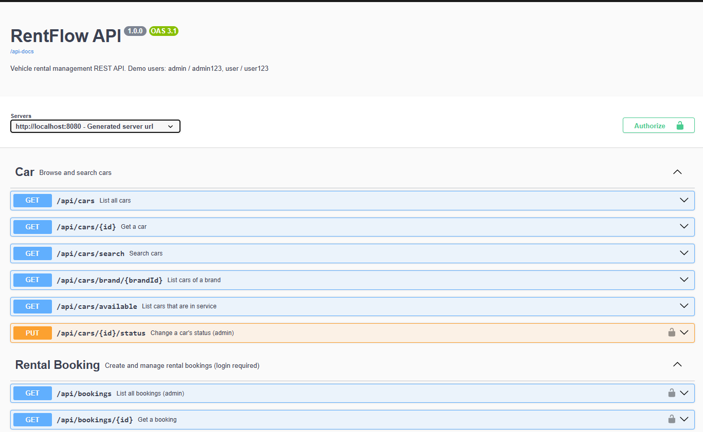
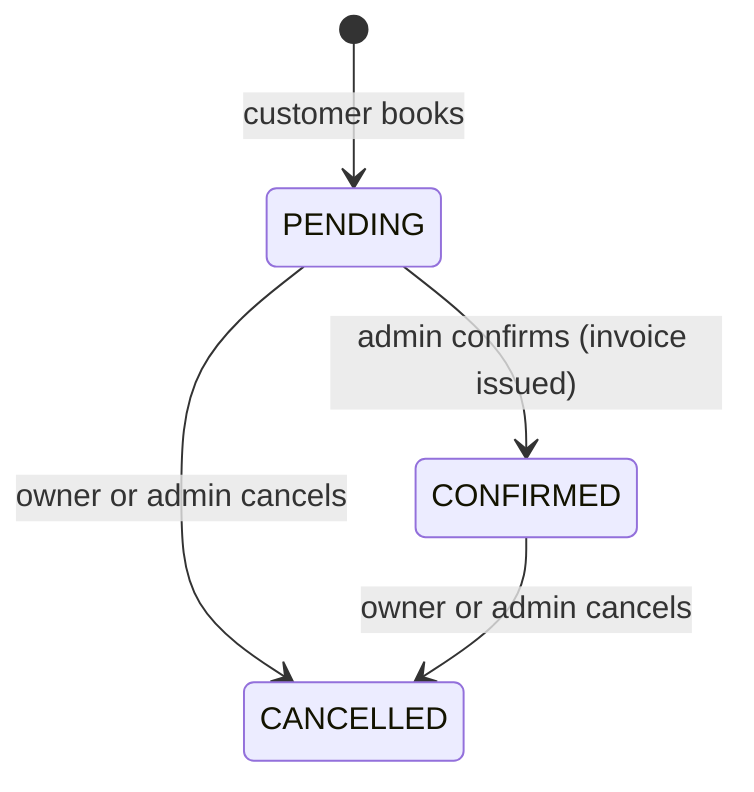
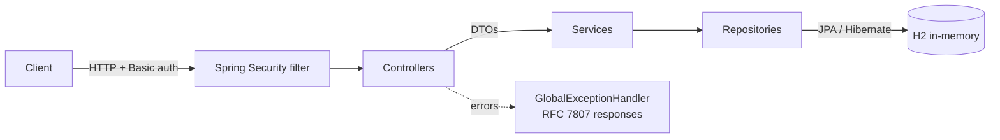
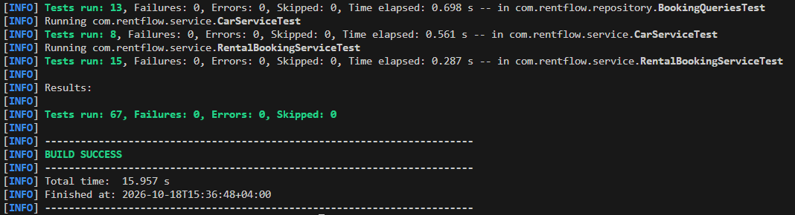

# RentFlow – Vehicle Rental REST API

[](https://github.com/besnikemini5/rentflow-api/actions/workflows/ci.yml)


RentFlow is a REST API for a car rental business. Customers browse cars, check availability for a date range and book a car; admins confirm bookings (which issues an invoice) and take cars out of service.

The project focuses on **correct business rules, role-based security and thorough automated testing**: 67 tests cover the service logic, the database queries and the full HTTP API, including authentication and authorization.



## Features

- **Car catalogue**: browse cars, filter by brand and pickup location, and search availability for a date range
- **Bookings**: create, view, confirm and cancel, with price calculation and double-booking prevention
- **Role-based security**: public catalogue; logged-in customers manage only their own bookings; admin-only actions are enforced on the server
- **Invoices**: issued automatically when an admin confirms a booking
- **Consistent errors**: every error is returned as [RFC 7807](https://www.rfc-editor.org/rfc/rfc7807) problem JSON with the correct status code (400, 401, 403, 404, 409)
- **Interactive docs**: Swagger UI with an "Authorize" button for the demo users

## Tech stack

Java 17 · Spring Boot 3.5 · Spring Web · Spring Data JPA (Hibernate) · Spring Security (HTTP Basic, BCrypt) · Bean Validation · H2 (in-memory) · springdoc-openapi (Swagger UI) · Lombok · JUnit 5 · Mockito · MockMvc · AssertJ · Maven · GitHub Actions

## Getting started

**Requirement:** JDK 17 or newer (`java -version`). Maven does not need to be installed; the included Maven Wrapper downloads it.

```bash
git clone https://github.com/besnikemini5/rentflow-api.git
cd rentflow-api

# Windows (PowerShell)
.\mvnw.cmd spring-boot:run

# macOS / Linux
./mvnw spring-boot:run
```

Then open **http://localhost:8080/swagger-ui.html**.

The database is in-memory and is re-created with demo data on every start.

### Demo users

| Username | Password   | Role     |
|----------|------------|----------|
| `admin`  | `admin123` | ADMIN    |
| `user`   | `user123`  | CUSTOMER |

In Swagger UI, click **Authorize** and enter one of these. They are demo credentials for a local in-memory database, not real secrets.

## API overview

| Method | Endpoint | Access | Description |
|--------|----------|--------|-------------|
| GET | `/api/cars` | Public | All cars |
| GET | `/api/cars/available` | Public | Cars that are in service |
| GET | `/api/cars/search` | Public | Filter by `brandId`, `locationId`, `startDate` + `endDate` |
| GET | `/api/cars/brand/{brandId}` | Public | Cars of one brand |
| GET | `/api/cars/{id}` | Public | One car |
| PUT | `/api/cars/{id}/status?status=OUT_OF_SERVICE` | Admin | Take a car out of (or back into) service |
| GET | `/api/brands`, `/api/brands/{id}` | Public | Brands |
| GET | `/api/locations`, `/api/locations/{id}`, `/api/locations/city/{city}` | Public | Pickup locations |
| POST | `/api/bookings` | Logged in | Book a car for yourself |
| GET | `/api/bookings/my-bookings` | Logged in | Your bookings |
| GET | `/api/bookings/{id}` | Owner or admin | One booking |
| PUT | `/api/bookings/{id}/cancel` | Owner or admin | Cancel a booking |
| PUT | `/api/bookings/{id}/confirm` | Admin | Confirm a booking and issue the invoice |
| GET | `/api/bookings` | Admin | All bookings |

### Example: book a car

```bash
curl -u user:user123 -X POST http://localhost:8080/api/bookings \
  -H "Content-Type: application/json" \
  -d '{
        "carId": 1,
        "startDate": "2030-03-10",
        "endDate": "2030-03-14",
        "pickupLocationId": 1,
        "dropoffLocationId": 2
      }'
```

The response is `201 Created` with the booking (`"status": "PENDING"`, `"totalCost": 250.00`: 5 days × 50.00).

### Example error

Booking the same car for overlapping dates returns `409 Conflict`:

```json
{
  "type": "about:blank",
  "title": "Booking Overlap",
  "status": 409,
  "detail": "Car with id 1 is already booked for the requested date range",
  "instance": "/api/bookings",
  "timestamp": "2030-03-01T10:15:30Z"
}
```

## Business rules

- Dates are **inclusive**: a booking from the 10th to the 14th is 5 paid days, and a same-day rental is 1 day.
- A car cannot be double-booked. Two bookings overlap when each starts on or before the day the other ends; cancelled bookings free their dates. The car row is locked during booking, so two simultaneous requests cannot both succeed.
- A car is picked up at its own location; drop-off can be at any location.
- Out-of-service cars cannot be booked and do not appear in availability search.
- Booking lifecycle:



Invalid transitions, such as confirming a cancelled booking or cancelling twice, return `409 Conflict`.

## Architecture



```
src/main/java/com/rentflow
├── config/        Security, OpenAPI and demo-data setup
├── controller/    REST endpoints and the global exception handler
├── dto/           Request and response objects (entities are never exposed directly)
├── entity/        JPA entities
├── exception/     Domain exceptions mapped to HTTP status codes
├── repository/    Spring Data JPA repositories and JPQL queries
├── security/      Loads users from the database for authentication
└── service/       Business logic
```

## Testing

```bash
.\mvnw.cmd test      # Windows
./mvnw test          # macOS / Linux
```

| Test class | Type | What it covers |
|------------|------|----------------|
| `RentalBookingServiceTest` | Unit (Mockito) | Pricing, overlap rejection, pickup-location rule, out-of-service cars, status transitions, ownership checks |
| `CarServiceTest` | Unit (Mockito) | Search validation, mapping, not-found handling |
| `BookingQueriesTest` | Repository (`@DataJpaTest`) | The real overlap and availability queries against a database, including boundary cases: same day, day before/after, cancelled bookings |
| `RentFlowApiTest` | End-to-end (`@SpringBootTest` + MockMvc) | Real HTTP requests through security and the database: 401/403 rules, validation errors, 404/409 responses, booking flows, regression tests |



Every push runs the full test suite on GitHub Actions.

### Bugs found and fixed

This project started as a working prototype. A code review found several real defects, which were fixed. Each one is now covered by a regression test, so it cannot come back unnoticed:

- Anyone, even without logging in, could change a car's status.
- Any customer could list all bookings, including other customers' emails, and view, confirm or cancel other people's bookings by changing the ID in the URL (IDOR).
- Booking a car for a future date marked it as rented immediately, hiding it from availability search for **all** dates.
- Confirmed or cancelled bookings could be confirmed or cancelled again.
- Location search only found cars that had been booked before.
- "Not found" errors returned `400` instead of `404`, and unexpected errors could leak internal messages.

## Known limitations

- HTTP Basic auth and an in-memory database keep the demo easy to run; a production version would use token-based auth (e.g. JWT) and a persistent database such as PostgreSQL.
- There is no user registration endpoint; the demo users are created at startup.
- Cancelling a confirmed booking does not issue a refund or void the invoice.
- After a one-way rental, the car's location is not updated to the drop-off location.

## Author

**Besnik Emini** · [GitHub](https://github.com/besnikemini5) · [LinkedIn](https://www.linkedin.com/in/besnikemini1)
